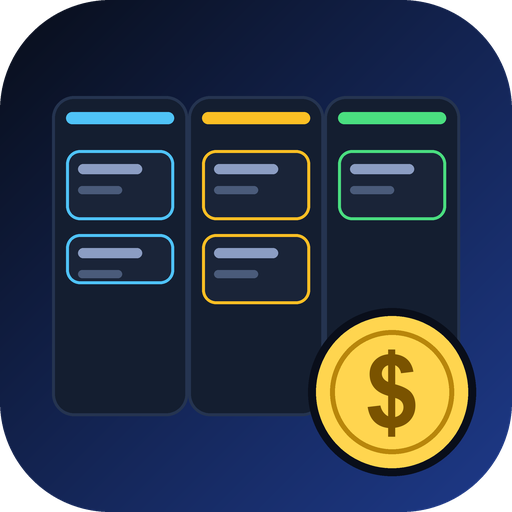

<p align="center">
  
</p>

# Kanban Finance System (Next.js)

A web app for tracking savings, investments and financial goals on Kanban boards. Built with Next.js and Firebase (Auth + Firestore).

Built with **Next.js 14 (App Router)**, **TailwindCSS**, **react-icons**, and **Firebase (Auth + Firestore)**. Connects to the **same Firebase project** (`kanban-finance-system`) as the Flutter companion app, so accounts, bank cards and transactions stay in sync.

## Features

- Firebase email/password auth (login, register, password reset)
- Bank account CRUD with bank-specific gradient cards
- Transactions (credit / debit) per account
- Two kanban boards:
  - Per-account: drag transactions across **Pending, Processing, Completed, Failed** to update status
  - Cross-account: drag transactions between bank accounts to reassign
- Wealth dashboard (monthly inflow/outflow, net flow, category breakdown)
- Profile management
- Dark "Vault" theme (always on)
- Responsive layout for mobile, tablet and desktop

## Run locally

```bash
npm install
npm run dev          # http://localhost:3000
npm run build        # production build
npm start            # serve production build
```

The Firebase web config is hard-coded in `src/lib/firebase.ts` (same credentials as the Flutter app's `firebase_options.dart`).
